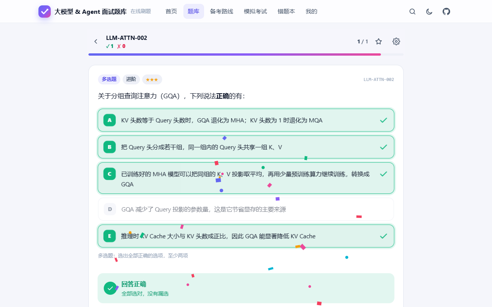

<div align="center">


# 大模型 &amp; Agent 面试题库

**LLM & Agent Interview Bank** · 2845 道原创题 · 12 种题型 · 每题都有讲解 · 在线刷题与模拟考试

[](https://anticipate218.github.io/llm-agent-interview-bank/)

[](#题库规模)
[](docs/taxonomy.md)
[](https://github.com/anticipate218/llm-agent-interview-bank/actions/workflows/validate.yml)
[](LICENSE-CONTENT)
[](LICENSE)

</div>


## 在线刷题

打开 **[https://anticipate218.github.io/llm-agent-interview-bank/](https://anticipate218.github.io/llm-agent-interview-bank/)** 就能开始，不用注册，电脑和手机都能用，也可以「添加到主屏幕」后离线刷题。

- **即时判分**：答对时选项打勾、彩带飞出，连对 5、10、20 题有里程碑庆祝；答错时选项抖动并标出正确答案，题目自动收进错题本。
- **主观题自评**：简答、场景、设计、计算与编程题给出参考答案，对照评分要点逐条勾选，自动算分。
- **灵活练习**：按大类、小类、题型、难度筛选，顺序或随机，「只做新题」「只做错过的」；进度自动保存，刷新后接着做。
- **备考路线**：实习必刷、大模型算法岗、Agent 应用开发岗、推理与工程岗、手撕代码、挑战题。
- **模拟考试**：按岗位一键组卷，倒计时、答题卡、交卷自动判分（多选少选得一半、填空按空给分），可逐题回顾。
- **学习统计**：做题热力图、各领域正确率、连续打卡天数；数据只保存在本机浏览器，可导出备份。
- **顺手**：电脑上用键盘刷题（`A`–`E` 选择、`Enter` 提交、`←` `→` 翻题），手机上左右滑动翻题；支持深色模式。




## 特点

- **覆盖广**：11 个大类、70 个小类、861 个考点。从机器学习基础、Transformer 架构、预训练与对齐、推理部署、RAG，到 Agent 的工具调用、协议、记忆、框架、多 Agent、运行时、应用与 Agentic RL，再到评测、工程化、安全，以及编程与计算机基础。
- **题型全**：单选、多选、判断、填空、计算、代码输出、代码填空、代码改错、编程、简答、场景分析、系统设计，共 12 种题型，覆盖笔试与面试的各种考法。
- **讲解透**：客观题先给结论，再讲原理，并逐项点评每个选项；主观题提供分点参考答案、评分要点（总分 10 分）与常见失分点。
- **可验证**：代码类题目由校验脚本真正运行，核对输出、跑通测试，并确认改错题的 bug 真实存在；全库自动检查格式、答案合法性与重复题目。
- **严格质检**：每道客观题都由独立复核者在不看答案的情况下重做并逐题裁决；涉及产品、协议、版本和论文数字的题对照官方资料核实并注明出处；选项长度、正确答案的位置和个数都做了均衡，不能靠「选最长的」「多选就选前三个」这类规律猜对。详见[题库设计](docs/题库设计.md#6-质量保障)。
- **可组卷**：按岗位预设一键生成模拟卷，试卷与答案分开。
- **数据开放**：YAML 源数据，另有 JSON 与 CSV 导出，方便做刷题工具或导入 Anki。

## 题库规模

<!-- STATS:START -->
| 大类 | 小类数 | 题量 |
|---|---|---|
| FND 机器学习与深度学习基础 | 5 | 191 |
| LLM 大模型原理 | 9 | 356 |
| TRN 预训练与微调 | 7 | 295 |
| ALN 对齐与强化学习 | 6 | 252 |
| INF 推理与部署 | 7 | 278 |
| RAG 检索增强生成 | 7 | 245 |
| AGT 智能体 Agent | 12 | 556 |
| EVL 评测 | 2 | 91 |
| ENG 工程化与系统设计 | 4 | 160 |
| SEC 安全与可靠性 | 4 | 143 |
| CS 编程与计算机基础 | 7 | 278 |
| **合计** | **70** | **2845** |

题型分布：单选题 807，多选题 400，判断题 366，填空题 177，计算题 237，代码输出题 130，代码填空题 45，代码改错题 68，编程题 101，简答题 315，场景分析题 150，系统设计题 49。
难度分布：基础 714，进阶 1583，挑战 548。
<!-- STATS:END -->

## 分类体系

<!-- TAXONOMY:START -->
| 大类 | 小类 |
|---|---|
| **FND** 机器学习与深度学习基础 | 数学基础 · 机器学习基础 · 深度学习基础 · 优化与训练技巧 · NLP 基础 |
| **LLM** 大模型原理 | Transformer 整体架构 · 注意力机制 · 位置编码与长上下文 · Tokenizer 与 Embedding · 混合专家 MoE · 解码与生成 · 主流模型与演进 · 多模态大模型 · 新架构与前沿 |
| **TRN** 预训练与微调 | 预训练与 Scaling Law · 数据工程 · 分布式训练 · 显存与混合精度 · 指令微调 SFT · 参数高效微调 · 领域适配与蒸馏 |
| **ALN** 对齐与强化学习 | 强化学习基础 · RLHF 与 PPO · 偏好优化 DPO 系列 · GRPO 与可验证奖励 · 奖励设计与奖励黑客 · 推理模型与测试时计算 |
| **INF** 推理与部署 | 推理流程与性能指标 · KV Cache 与显存管理 · 批处理与调度 · 算子与 FlashAttention · 量化与压缩 · 投机解码 · 推理服务与框架 |
| **RAG** 检索增强生成 | RAG 原理与选型 · 文档解析与切块 · Embedding 与向量索引 · 稀疏检索、混合检索与重排 · 查询理解与生成控制 · 高级 RAG 范式 · RAG 评测与运维 |
| **AGT** 智能体 Agent | Agent 基础与范式 · 提示工程与结构化输出 · 推理与规划 · 反思与自我改进 · 工具调用 · 智能体协议 · 记忆与上下文工程 · Agent 框架 · 多 Agent 与长程任务 · Harness 与编码 Agent 运行时 · Agent 应用 · Agentic RL 与自我进化 |
| **EVL** 评测 | 大模型评测 · Agent 评测 |
| **ENG** 工程化与系统设计 | 稳定性与容错 · 可观测性与 LLMOps · 成本与性能优化 · 系统设计 |
| **SEC** 安全与可靠性 | 提示注入与越狱 · Agent 安全 · 防御体系与治理 · 可靠性、幻觉与合规 |
| **CS** 编程与计算机基础 | Python · PyTorch · 算法与数据结构 · SQL 与数据库 · 计算机网络 · 操作系统与并发 · 分布式系统 |
<!-- TAXONOMY:END -->

每个小类下有 7～17 个考点，完整的考点清单与当前覆盖情况见 [docs/taxonomy.md](docs/taxonomy.md)。

## 题型

| 题型 | 代码 | 考查重点 | 组卷默认分值 |
|---|---|---|---|
| 单选题 | `single` | 概念辨析，4 个选项中只有 1 个正确 | 2 |
| 多选题 | `multiple` | 全面理解，2～4 个正确选项 | 3 |
| 判断题 | `judge` | 常见误解的辨别 | 1 |
| 填空题 | `fill` | 关键术语与关键数值 | 2 |
| 计算题 | `calc` | 显存、算力、复杂度、指标等量化估算 | 5 |
| 代码输出题 | `code_output` | 读代码、理解 API 行为 | 3 |
| 代码填空题 | `code_fill` | 关键实现细节 | 4 |
| 代码改错题 | `code_debug` | 找出并修正常见 bug | 6 |
| 编程题 | `coding` | 手撕实现（附参考实现与测试） | 12 |
| 简答题 | `short` | 原理阐述与方案比较 | 8 |
| 场景分析题 | `scenario` | 线上问题排查、方案取舍 | 12 |
| 系统设计题 | `design` | 端到端系统设计 | 15 |

难度分为 **基础 / 进阶 / 挑战** 三档；考频分为 ★（偶尔考）、★★（常考）、★★★（高频必考）三档。

## 其他用法

1. **在 GitHub 上直接阅读**：从 [docs/README.md](docs/README.md) 进入，按小类浏览；答案和解析默认折叠，也可以[按题型浏览](docs/README.md#按题型浏览)。
2. **生成模拟卷（Markdown）**：

   ```bash
   pip install pyyaml
   python scripts/make_exam.py --list                        # 查看预设：算法岗、Agent 应用岗、工程岗、编程基础、综合卷
   python scripts/make_exam.py --preset agent-app --seed 1   # 生成 exams/agent-app-s1.md 与参考答案
   ```

   也可以自定义范围和题量，例如 `--domains LLM,INF --single 20 --calc 3 --short 2`。[exams/](exams/) 中有每个预设的一套样例。
3. **使用数据**：`dist/questions.json`（结构化全量数据）、`dist/questions.csv`（表格，可导入 Anki 等工具）。
4. **本地运行刷题网站**：

   ```bash
   pip install pyyaml
   python scripts/build_site.py          # 生成 site/data/
   python -m http.server -d site 8000    # 浏览器打开 http://localhost:8000
   ```

## 目录结构

```text
├── taxonomy.yaml          分类体系：大类 → 小类 → 考点
├── questions/             题目源数据（YAML），按 大类/小类.yaml 组织
├── site/                  在线刷题网站（纯静态，无需构建工具）
├── docs/                  自动生成的浏览页面（练习页、题型索引、分类体系表）与设计文档
├── dist/                  自动生成的数据文件（JSON、CSV）
├── exams/                 模拟卷样例（每个预设一套，种子 1）
├── scripts/
│   ├── validate.py        校验：格式、答案合法性、代码运行、查重、覆盖与答案分布统计
│   ├── build.py           生成 docs/ 与 dist/，更新本页统计
│   ├── build_site.py      生成网站数据 site/data/
│   ├── make_exam.py       组卷
│   ├── blind_review.py    盲答复核：导出不含答案的客观题，比对作答结果
│   └── append_batch.py    把草稿批量追加到题目文件
├── .github/workflows/     CI：校验题目、检查生成文件、部署网站到 GitHub Pages
├── CONTRIBUTING.md        出题规范与贡献指南
└── docs/题库设计.md        题库设计说明
```

## 参与贡献

欢迎补充新题、修正错误、完善讲解。请先阅读 [出题规范](CONTRIBUTING.md)，提交前运行：

```bash
pip install pyyaml numpy torch  # 代码题按 Python 3.13 + PyTorch（CPU 版即可）核对，与 CI 一致
python scripts/validate.py      # 不能有 ERROR
python scripts/build.py         # 重新生成 docs/ 与 dist/
```

发现答案或讲解有误，欢迎直接提 [Issue](https://github.com/anticipate218/llm-agent-interview-bank/issues)，注明题目编号（如 `LLM-ATTN-004`）。网站右上角的题号点一下就能复制。

## 致谢

考点调研参考了以下公开资料（只借鉴「考什么」，题目与讲解均为原创），感谢这些作者的分享：

- [wdndev / llm_interview_note](https://github.com/wdndev/llm_interview_note)
- [Lau-Jonathan / LLM-Agent-Interview-Guide](https://github.com/Lau-Jonathan/LLM-Agent-Interview-Guide)
- [datawhalechina / hello-agents（面试问题总结）](https://github.com/datawhalechina/hello-agents)
- [adongwanai / AgentGuide](https://github.com/adongwanai/AgentGuide)
- [Zchary1106 / agent-interview-hub](https://github.com/Zchary1106/agent-interview-hub)
- [llmgenai / LLMInterviewQuestions](https://github.com/llmgenai/LLMInterviewQuestions)
- [KalyanKS-NLP / LLM-Interview-Questions-and-Answers-Hub](https://github.com/KalyanKS-NLP/LLM-Interview-Questions-and-Answers-Hub)
- [ombharatiya / AI-Engineer-Interview-Questions](https://github.com/ombharatiya/AI-Engineer-Interview-Questions)
- [amitshekhariitbhu / ai-engineering-interview-questions](https://github.com/amitshekhariitbhu/ai-engineering-interview-questions)
- [keepkeen 的大模型与 Agent 面经汇总系列博客](https://keepkeen.github.io/blog/)
- [代码随想录笔记：Agent / 大模型面试题汇总](https://notes.kamacoder.com/interview/llm/agent_interview.html)
- [牛客网上公开的大模型、Agent 与推理岗面经](https://www.nowcoder.com/)
- [AI Engineering Insider：The 100 Questions That Haunt AI Engineering Interviews](https://aiengineeringinsider.substack.com/p/the-100-questions-that-haunt-ai-engineering)

## 声明

- 本题库的题目均为基于公开知识的原创整理，考点参考了字节跳动、阿里巴巴、腾讯、华为、美团等公司大模型与 Agent 岗位的公开面经，**不是任何公司的真题**，仅供学习与面试准备使用。
- 题目的编写与复核大量借助了 AI 工具，并经过自动校验、代码实际运行、联网核实与独立盲答复核，但仍可能存在错误。
- 大模型领域发展很快，个别内容可能过时，欢迎指正。涉及论文和产品的内容以原始论文与官方文档为准，出处见题目的 `source` 字段；题目中注明的时间（如「截至 2026 年 11 月」）是核实时的状态。

## 许可证

- **题目与文档**（`questions/`、`taxonomy.yaml`、`docs/`、`exams/`、`dist/`）：[CC BY-SA 4.0](https://creativecommons.org/licenses/by-sa/4.0/deed.zh-hans)，全文见 [LICENSE-CONTENT](LICENSE-CONTENT)。转载或改编请注明出处，并以相同协议共享。
- **代码**（`scripts/`、`site/`）：[MIT](LICENSE)。
- `site/assets/vendor/` 中的 [KaTeX](https://katex.org)（MIT）、[markdown-it](https://github.com/markdown-it/markdown-it)（MIT）与 [highlight.js](https://highlightjs.org)（BSD-3-Clause）保留各自的许可证。
